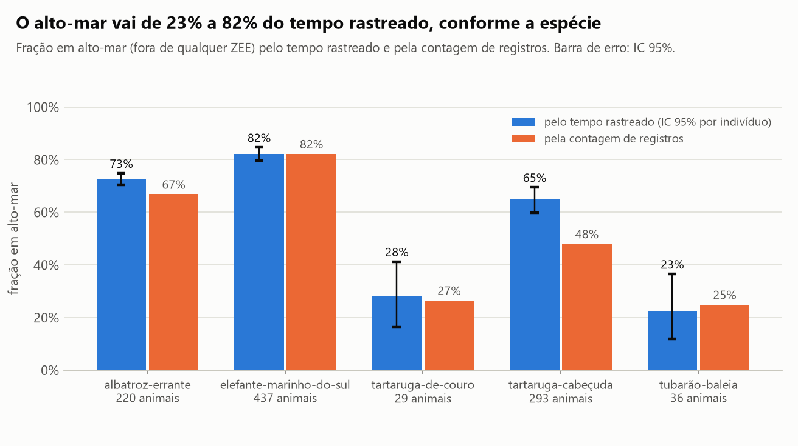
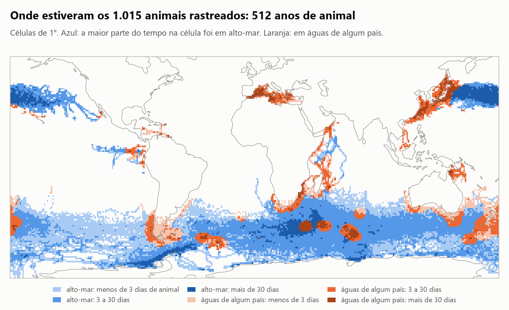
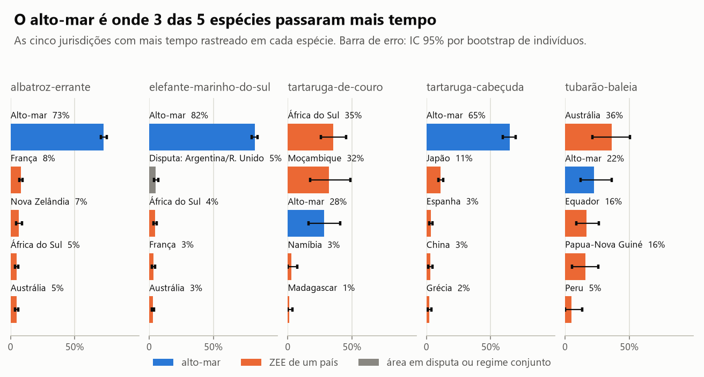
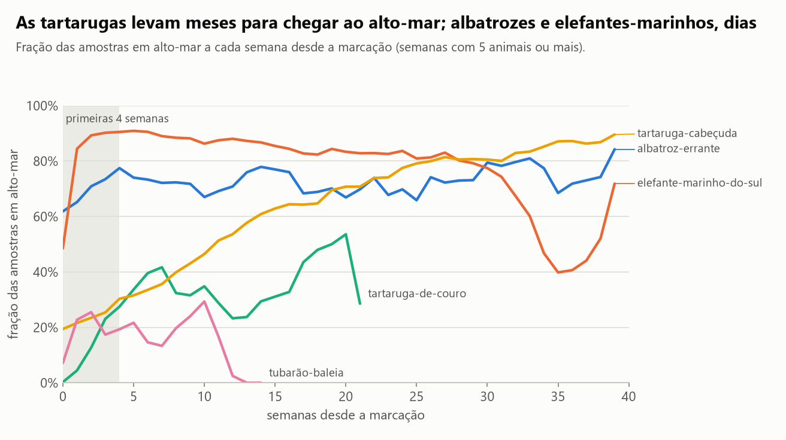
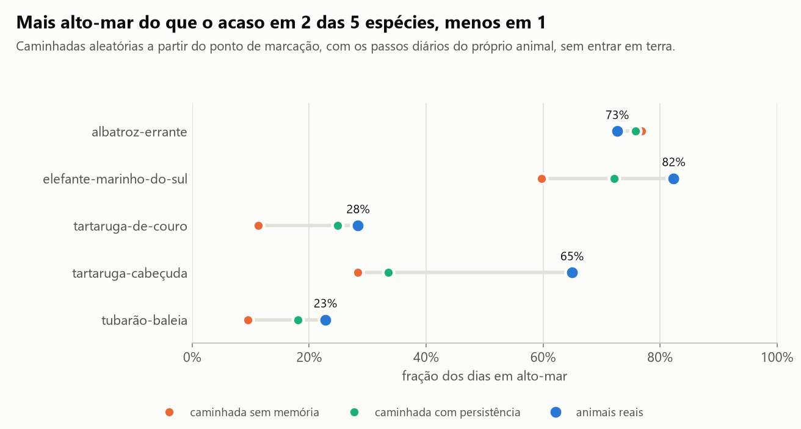
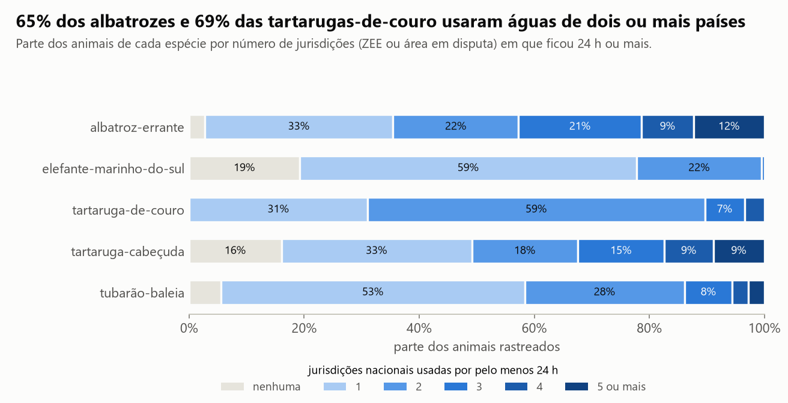

# Quanto do caminho de um animal marinho migratório passa por águas de algum país, e quanto por alto-mar?

Tartarugas, tubarões-baleia, elefantes-marinhos e albatrozes cruzam oceanos inteiros. Proteger a praia de desova ou
a colônia não protege a rota. A decisão que este estudo informa: para que espécies, e em que trechos de oceano, a
cooperação entre países (ou a proteção em alto-mar) importa mais.

**A resposta, com o que os dados públicos sustentam:** entre 1.015 animais rastreados por satélite, de cinco
espécies, a fração do tempo em alto-mar (fora de qualquer Zona Econômica Exclusiva) vai de **23%** no tubarão-baleia
(IC 95%: 12% a 37%) a **82%** no elefante-marinho-do-sul (80% a 85%). O número depende tanto de onde a espécie foi
marcada quanto da espécie: as tartarugas-cabeçudas do Pacífico Norte passaram 76% do tempo em alto-mar; as do
Mediterrâneo, 0%. Contar registros em vez de tempo, que é a conta simples, empata em três das cinco espécies e erra
17 pontos percentuais na tartaruga-cabeçuda (48% em vez de 65%).

É análise de dado público agregado, feita por um profissional de dados. Os números descrevem os animais que alguém
marcou, não a espécie inteira, e "alto-mar" aqui é uma categoria jurídica, não uma medida de proteção.

## Em 30 segundos

- **O dado:** 1.151.680 posições de 1.097 rastreamentos em 15 conjuntos públicos do OBIS, coletados em 12/11/2026.
  Depois da limpeza ficam 1.015 animais e 512 anos de animal rastreado, de 1996 a 2024, classificados numa grade
  de 0,1° feita com as Zonas Econômicas Exclusivas (ZEE) do Marine Regions.
- **Três espécies passaram a maior parte do tempo em alto-mar:** elefante-marinho-do-sul (82%), albatroz-errante
  (73%) e tartaruga-cabeçuda (65%). A tartaruga-de-couro da África do Sul (28%) e o tubarão-baleia (23%) ficaram
  principalmente em águas de dois ou três países.
- **A conta por registros erra onde os transmissores são desiguais, e quase só por isso.** Dentro de cada
  trajetória, registros e tempo dão quase o mesmo (diferença de até 0,7 ponto). O erro vem de animais com
  transmissor mais falante pesarem mais: 17 pontos na tartaruga-cabeçuda, 6 no albatroz.
- **O intervalo honesto é de 9 a 31 vezes mais largo que o ingênuo.** Tratar cada posição como independente dá uma
  certeza que não existe: mil posições do mesmo animal são um animal.
- **O local de marcação pesa nas tartarugas e não pesa nos outros.** Descartando os primeiros 56 dias de cada
  trajetória, a tartaruga-cabeçuda vai de 65% para 76% em alto-mar e a de couro, de 28% para 34%. Albatroz,
  elefante-marinho e tubarão-baleia mudam no máximo 3 pontos.
- **Contra o acaso:** elefantes-marinhos e tartarugas-cabeçudas usam o alto-mar mais do que caminhadas aleatórias
  com os mesmos passos; o albatroz-errante, um pouco menos (ele sempre volta à colônia); para tartaruga-de-couro e
  tubarão-baleia, os dados não separam.
- **Um mesmo animal usa águas de vários países:** 65% dos albatrozes e 69% das tartarugas-de-couro ficaram pelo
  menos um dia em duas ou mais jurisdições nacionais; o máximo foi oito.

## As figuras

### 1. Tempo, não pontos



A barra azul é a medida do estudo: a fração do tempo rastreado em alto-mar, com o intervalo de 95% reamostrando
animais inteiros. A laranja é a conta que se faz sem pensar: a fração dos registros.

| Espécie | Animais | Alto-mar pelo tempo (IC 95%) | Alto-mar pelos registros | Diferença, em pontos (IC 95%) |
|---|---|---|---|---|
| Albatroz-errante (*Diomedea exulans*) | 220 | 73% (70% a 75%) | 67% | +5,7 (3,7 a 8,0) |
| Elefante-marinho-do-sul (*Mirounga leonina*) | 437 | 82% (80% a 85%) | 82% | 0,0 |
| Tartaruga-de-couro (*Dermochelys coriacea*) | 29 | 28% (16% a 41%) | 27% | +1,7 (−4,8 a 8,1) |
| Tartaruga-cabeçuda (*Caretta caretta*) | 293 | 65% (60% a 69%) | 48% | +16,8 (12,6 a 20,7) |
| Tubarão-baleia (*Rhincodon typus*) | 36 | 23% (12% a 37%) | 25% | −2,4 (−9,3 a 3,5) |

O empate no elefante-marinho é por construção: o conjunto RAATD já publica as posições filtradas por um modelo e
espaçadas de 2 em 2 horas, então registro e tempo são a mesma coisa. Nas duas espécies em que a diferença é real,
ela foi decomposta. Refazendo a conta por registros, mas com cada animal pesando pelo seu tempo, sobra 0,0 ponto de
erro no albatroz e −0,4 na tartaruga-cabeçuda. O resto (5,7 e 17,2 pontos) vem de quem transmite mais pesar mais: no
caso das cabeçudas, o conjunto do Mediterrâneo ocidental tem 23% dos registros e fica todo dentro de ZEE.



O mapa soma as cinco espécies em células de 1°. O azul do Oceano Austral são albatrozes e elefantes-marinhos; a
faixa azul do Pacífico Norte são tartarugas-cabeçudas; o laranja em volta do Japão, no Mediterrâneo e no canal de
Moçambique são tartarugas em águas nacionais.

### 2. Em que jurisdições



| Espécie | 1ª | 2ª | 3ª |
|---|---|---|---|
| Albatroz-errante | Alto-mar, 73% | França, 8% | Nova Zelândia, 7% |
| Elefante-marinho-do-sul | Alto-mar, 82% | Área em disputa Argentina / Reino Unido, 5% | África do Sul, 4% |
| Tartaruga-de-couro | África do Sul, 35% | Moçambique, 32% | Alto-mar, 28% |
| Tartaruga-cabeçuda | Alto-mar, 65% | Japão, 11% | Espanha, 3% |
| Tubarão-baleia | Austrália, 36% | Alto-mar, 23% | Equador, 16% |

Os países da tabela são os soberanos, e isso esconde a geografia: a "França" do albatroz e do elefante-marinho são as
ilhas Crozet e Kerguelen; a "África do Sul", as ilhas Príncipe Eduardo; a área em disputa, a Geórgia do Sul e as
Sandwich do Sul; o "Equador" do tubarão-baleia, quase todo, Galápagos. A tabela completa, com 69 jurisdições
nacionais e intervalo em cada linha, está em [`reports/tempo_por_jurisdicao.csv`](reports/tempo_por_jurisdicao.csv).

Para o elefante-marinho, "alto-mar" precisa de uma ressalva: 45% do tempo total dele (55% do tempo em alto-mar) foi
ao sul de 60°S, a área do Tratado da Antártida, onde nenhuma ZEE é reconhecida, mas onde já existe um regime de
gestão próprio. O alto-mar ao norte de 60°S responde por 37% do tempo do elefante-marinho e por 70% do tempo do
albatroz.

**Os trechos de alto-mar mais usados** (blocos de 10°):

| Espécie | Trecho | Parte do tempo da espécie |
|---|---|---|
| Tartaruga-cabeçuda | Pacífico Norte, 30° a 40°N, de 160°L a 170°O (três blocos) | 28% |
| Elefante-marinho-do-sul | 60° a 70°S, de 50° a 80°O, a oeste da Península Antártica (três blocos) | 20% |
| Tubarão-baleia | Pacífico leste, 0° a 10°N, de 80° a 110°O (três blocos) | 15% |
| Tartaruga-de-couro | 30° a 40°S, 30° a 40°L, a sudeste da África do Sul | 8% |
| Albatroz-errante | 40° a 50°S, 40° a 50°L, no setor índico do Oceano Austral | 5% |

O alto-mar da tartaruga-cabeçuda é concentrado: três blocos vizinhos somam 44% de todo o tempo dela em alto-mar. O
do albatroz é o oposto: são precisas 916 das 7.845 células de 1° que ele usou para somar metade do tempo.

### 3. O viés de onde se marca



Animais são marcados onde é possível pegá-los: na praia, na colônia, no ponto de agregação. O começo de toda
trajetória é costeiro por construção. Na semana da marcação, 19% das amostras de tartaruga-cabeçuda estão em
alto-mar; na 12ª semana, 54%; na 26ª, 80%. A tartaruga-de-couro sai de 0% e chega a 54% na 20ª semana. O
elefante-marinho vai de 49% a 84% em uma semana. A queda dele por volta da 35ª semana, para 40%, é compatível com a volta às ilhas.

| Espécie | Trajetória inteira | Sem os primeiros 56 dias (IC 95%) | Animais que sobram |
|---|---|---|---|
| Albatroz-errante | 73% | 73% (70% a 76%) | 125 de 220 |
| Elefante-marinho-do-sul | 82% | 81% (79% a 84%) | 412 de 437 |
| Tartaruga-de-couro | 28% | 34% (17% a 53%) | 24 de 29 |
| Tartaruga-cabeçuda | 65% | 76% (71% a 81%) | 263 de 293 |
| Tubarão-baleia | 23% | 25% (13% a 42%) | 27 de 36 |

Para as tartarugas, o número da trajetória inteira subestima o alto-mar. Quanto, depende de quantos dias se
descarta, e essa escolha não tem resposta certa: por isso o número principal do estudo é o da trajetória inteira, e
este teste fica ao lado.

### 4. A mesma espécie, populações diferentes

| Espécie | Onde foi marcada | Animais | Alto-mar (IC 95%) |
|---|---|---|---|
| Tartaruga-cabeçuda | Pacífico Norte | 210 | 76% (71% a 80%) |
| Tartaruga-cabeçuda | Índico sudoeste | 20 | 28% (16% a 42%) |
| Tartaruga-cabeçuda | Mediterrâneo | 59 | 0% |
| Tartaruga-cabeçuda | Caribe | 4 | 0% |
| Tubarão-baleia | Galápagos | 21 | 47% (31% a 65%) |
| Tubarão-baleia | Mar de Coral | 15 | 0% |

Os 65% da tartaruga-cabeçuda são, na prática, o número do Pacífico Norte, que tem 210 dos 293 animais. O 0% do
Mediterrâneo tem uma causa que não é biológica: no mapa do Marine Regions, o Mediterrâneo inteiro está dividido
entre os países costeiros, inclusive onde eles não declararam ZEE (ver "Onde este estudo falha").

### 5. Contra o acaso



A pergunta: o animal usa o alto-mar porque vai para lá, ou só porque anda muito? Para cada animal foram simuladas 40
caminhadas que partem do mesmo ponto e sorteiam os passos diários do próprio animal, sem entrar em terra. Na
caminhada sem memória, cada passo sai num rumo qualquer; na persistente, os giros também são sorteados dos giros do
animal, o que preserva o quanto ele anda reto.

| Espécie | Animais reais | Caminhada sem memória | Caminhada persistente | Diferença para a persistente (IC 95%) |
|---|---|---|---|---|
| Albatroz-errante | 73% | 77% | 76% | −3,1 (−5,2 a −1,2) |
| Elefante-marinho-do-sul | 82% | 60% | 72% | +10,2 (7,7 a 12,5) |
| Tartaruga-de-couro | 28% | 11% | 25% | +3,4 (−5,7 a 13,2) |
| Tartaruga-cabeçuda | 65% | 28% | 34% | +31,4 (27,2 a 35,2) |
| Tubarão-baleia | 23% | 9% | 18% | +4,7 (−3,2 a 13,6) |

A tartaruga-cabeçuda fica 31 pontos acima do que a caminhada persistente produz: o alto-mar do Pacífico Norte é
destino, não acidente. O albatroz fica abaixo das duas caminhadas, e isso diz mais sobre a hipótese nula do que
sobre a ave: ele volta à colônia para alimentar o filhote, e uma caminhada que nunca volta se afasta mais das ilhas
do que ele. Para a tartaruga-de-couro e o tubarão-baleia, com 29 e 36 animais, o uso do alto-mar fica acima da
caminhada sem memória e não se distingue da persistente.

### 6. Quantos países um animal usa



| Espécie | Usaram 2 ou mais jurisdições nacionais | Usaram 3 ou mais | Máximo | Nenhuma (só alto-mar) |
|---|---|---|---|---|
| Albatroz-errante | 65% | 43% | 8 | 3% |
| Elefante-marinho-do-sul | 22% | 0,5% | 3 | 19% |
| Tartaruga-de-couro | 69% | 10% | 4 | 0% |
| Tartaruga-cabeçuda | 51% | 32% | 8 | 16% |
| Tubarão-baleia | 42% | 14% | 6 | 6% |

Quem compartilha animais com quem: 89 albatrozes e 66 elefantes-marinhos usaram águas da França e da Austrália
(Kerguelen e as ilhas Heard e McDonald são vizinhas); 87 albatrozes, França e África do Sul; 36 tartarugas-cabeçudas,
o Japão e a área das Curilas em disputa com a Rússia; 24, Espanha e Argélia; 18 das 29 tartarugas-de-couro marcadas
na África do Sul usaram águas de Moçambique. A fronteira mais atravessada, porém, é a do alto-mar: 1.832 passagens de
albatrozes entre as ZEE francesas e o alto-mar.

## Como foi feito

1. **Sondagem.** Antes de desenhar a análise, conferi o que o OBIS tem de telemetria com identificador de indivíduo.
   Duas espécies candidatas caíram: o tubarão-azul só tem detecções em receptores acústicos fixos, e o conjunto do
   programa TOPP (tartaruga-de-couro do Pacífico, albatrozes do Pacífico Norte) está agregado por célula e dia, sem
   indivíduo. Ficaram cinco espécies e 15 conjuntos.
2. **Jurisdição.** Polígonos das ZEE (Marine Regions, v12) e do alto-mar, baixados pelo serviço WFS, simplificados
   com tolerância de 0,01° e pintados numa grade global de 0,1°. Áreas em disputa e regimes conjuntos são
   categorias próprias. Águas interiores e arquipelágicas recebem a jurisdição da ZEE vizinha. Ao sul de 60°S tudo
   conta como fora de jurisdição nacional. Na grade, o alto-mar ocupa 61% da área do oceano.
3. **Trajetória de cada animal.** Ordenação no tempo; posições com o mesmo instante viram uma; filtro de velocidade
   que tira posições que exigiriam mais que o teto da espécie (6 km/h para tartarugas, 10 para o tubarão-baleia, 12
   para o elefante-marinho, 110 para o albatroz) tanto para chegar quanto para sair; distância por grande círculo.
   O filtro tirou 14.343 posições, 13.179 delas de tartarugas-cabeçudas.
4. **Tempo.** Amostras a cada 6 horas ao longo da trajetória, por interpolação esférica entre posições
   consecutivas. Falhas de transmissão de mais de 10 dias não são interpoladas: aquele tempo não entra na conta.
   Ficam fora os rastreamentos com menos de 10 posições ou menos de 7 dias (82 de 1.097).
5. **Medida.** Fração do tempo somado de todos os animais da espécie em cada jurisdição. Quem foi rastreado por
   mais tempo pesa mais.
6. **Incerteza.** Bootstrap por indivíduo, 4.000 reamostras: sorteiam-se animais inteiros, nunca posições.
7. **Vieses testados.** Descarte dos primeiros 14, 28 e 56 dias; outra regra para falhas (3 dias, ou nenhuma);
   só animais com 30, 90 ou 180 dias; média por indivíduo em vez de tempo somado; população a população.
8. **Hipótese nula.** Duas caminhadas aleatórias por animal, descritas acima, com passos de um dia.

O núcleo (geodésia, filtro, interpolação, grade, caminhada, bootstrap) está implementado em NumPy e SciPy em
`src/rotas_protecao/` e conferido em `tests/` contra casos de resposta conhecida: 1° no equador mede 111,195 km;
uma caminhada sem memória de 100 passos de 10 km tem deslocamento quadrático médio de 100 × 10²; um animal que passa
metade do tempo de cada lado de uma fronteira e transmite dez vezes mais de um lado dá 50% pelo tempo e 9,9% pelos
registros. O `shapely` só entra para pintar os polígonos na grade.

As trajetórias são reconstruídas em `scripts/baixar_dados.py`, e não em `rodar_analise.py`, porque as posições não
podem ser versionadas (metade dos conjuntos é CC BY-NC). O que está em `data/` são agregados por animal, por espécie
e por célula.

## Comparação com a alternativa simples

A alternativa simples é "X% dos registros estão em alto-mar", com o intervalo de quem trata cada registro como
independente.

| Espécie | Método: tempo, IC por indivíduo | Simples: registros, IC ingênuo | Quem ganha |
|---|---|---|---|
| Albatroz-errante | 73% (70% a 75%) | 67% (67% a 67%) | Método: a conta simples erra 6 pontos |
| Elefante-marinho-do-sul | 82% (80% a 85%) | 82% (82% a 82%) | Empate na estimativa |
| Tartaruga-de-couro | 28% (16% a 41%) | 27% (25% a 28%) | Empate na estimativa |
| Tartaruga-cabeçuda | 65% (60% a 69%) | 48% (48% a 48%) | Método: a conta simples erra 17 pontos |
| Tubarão-baleia | 23% (12% a 37%) | 25% (24% a 26%) | Empate na estimativa |

Com todas as letras:

- **Na estimativa, a conta simples empata em três das cinco espécies.** Em duas delas porque os dados já vieram
  regularizados (elefante-marinho) ou quase (um dos dois conjuntos de tartaruga-de-couro é diário); no tubarão-baleia
  porque a diferença, de 2 pontos, é menor que a incerteza.
- **Onde erra, o erro não está onde eu esperava.** Eu esperava que o problema fosse a transmissão desigual ao longo
  da trajetória. Não é: dentro de cada animal, registros e tempo quase coincidem. O erro é de ponderação entre
  animais, e uma média ponderada pelo tempo de cada animal resolveria sem interpolar nada.
- **No intervalo, a conta simples perde sempre.** O intervalo por indivíduo é 9 vezes mais largo que o ingênuo na
  tartaruga-de-couro, 10 no albatroz, 11 no tubarão-baleia, 22 na tartaruga-cabeçuda e 31 no elefante-marinho.
- **A hipótese nula mais simples (sem memória) é fácil demais de bater.** Quatro espécies ficam acima dela. Contra a
  caminhada persistente, só duas.

## Onde este estudo falha

- **A amostra não é a espécie.** A tartaruga-de-couro aqui é só a população que desova na África do Sul; a do
  Pacífico, que é a que cruza o oceano, não está no OBIS com indivíduo. O tubarão-baleia são dois pontos de
  agregação. A tartaruga-cabeçuda é dominada pelo Pacífico Norte. Trocar o conjunto de populações troca o número.
- **O intervalo é condicional à amostra.** O bootstrap reamostra animais, mas não populações, colônias nem
  programas de marcação. A incerteza sobre "a espécie" é maior do que os intervalos mostram.
- **O Mediterrâneo sem alto-mar é uma convenção do mapa.** O Marine Regions divide o Mediterrâneo inteiro por
  linhas de equidistância, inclusive onde os países não declararam ZEE. O 0% das 59 tartarugas de lá reflete essa
  escolha. O mesmo vale para as áreas em disputa: os limites são os do Marine Regions e não têm valor jurídico.
- **Alto-mar não quer dizer sem regra, e ZEE não quer dizer protegida.** Há organizações regionais de pesca em
  alto-mar e um regime próprio ao sul de 60°S. Este estudo mede jurisdição, não proteção: o mapa mundial de áreas
  protegidas (WDPA) ficou de fora porque a licença dele restringe a redistribuição.
- **"Animal" é um identificador de rastreamento.** O mesmo animal marcado duas vezes conta duas vezes, e no RAATD o
  identificador de uma ave pode corresponder a uma viagem. 32% dos rastreamentos de albatroz e 38% dos de
  elefante-marinho já começam fora de qualquer ZEE.
- **A comparação entre tempo e registros só é informativa em parte dos dados.** O RAATD publica posições já
  filtradas por modelo de espaço de estados e regularizadas (2 horas no elefante-marinho; 1, 2 ou 12 horas no
  albatroz). As posições cruas de satélite estão nas tartarugas e no tubarão-baleia.
- **Tempo rastreado não é o ano do animal.** A duração mediana vai de 54 dias (tubarão-baleia) a 245 (albatroz).
  Transmissores falham, caem, e animais morrem; o que se mede é a fração do tempo em que houve sinal, quase sempre
  a partir da época de reprodução. Na tartaruga-cabeçuda, a metade de rastreamentos mais curtos tem 25% em
  alto-mar e a metade mais longa, 75% (em parte porque os rastreamentos do Pacífico são os mais longos). Com a
  média por indivíduo no lugar do tempo somado, o número dela cai de 65% para 45%.
- **O tubarão-baleia transmite só quando está na superfície.** 89% do intervalo entre a primeira e a última posição
  de cada animal são falhas de mais de 10 dias, fora da conta. Interpolando por cima das falhas, o alto-mar dele
  sobe de 23% para 33%; só 8 animais passam de 90 dias.
- **Erro de posição.** Posições Argos erram quilômetros; as de geolocalização por luz, usadas em parte dos
  albatrozes, erram em média 186 km (Phillips et al. 2004). A grade é de 0,1° e a interpolação liga posições por
  linha reta sobre o mar: cerca de 1% das amostras cai em terra.
- **A hipótese nula é pobre.** Não tem volta à colônia, corrente, gelo nem profundidade, e sorteia passos do
  próprio animal. O resultado do albatroz mostra o limite dela.
- **Escolhas minhas que mudam números:** o teto de velocidade de cada espécie, o limite de 10 dias para falhas
  (com 3 dias, a tartaruga-cabeçuda vai de 65% para 57%), o mínimo de 7 dias, as 24 horas para contar uma
  jurisdição como usada, e os limites de 2023 aplicados a rastreamentos desde 1996.

## O que faltaria para isto virar contribuição científica

- Revisão por quem estuda cada espécie: os tetos de velocidade, a regra de falhas e o que conta como um indivíduo
  em cada conjunto precisam ser conferidos na fonte, não deduzidos dos campos do OBIS.
- Cobertura de populações: pedir aos detentores os rastreamentos que não estão públicos com indivíduo (tartaruga-de-
  couro do Pacífico e do Atlântico, tubarão-baleia do Índico) e ponderar cada população pelo seu tamanho, como
  fazem Beal et al. (2021) para albatrozes e petréis.
- Modelo de espaço de estados nas posições cruas, com a classe de qualidade de cada posição Argos (que o OBIS não
  distribui), em vez de um filtro de velocidade.
- Ciclo anual completo: ponderar as fases (reprodução, migração, alimentação) pela duração real de cada uma, em vez
  do tempo em que o transmissor funcionou.
- Limites jurídicos reais: ZEE declaradas, não as linhas de equidistância, e as áreas de competência das
  organizações regionais de pesca e das áreas protegidas, com as licenças necessárias.
- Uma hipótese nula com retorno à colônia e com o ambiente (correntes, gelo, profundidade).
- Comparação formal com a literatura. Harrison et al. (2018) rastrearam 1.648 animais de 14 espécies no Pacífico e
  relatam que algumas passaram três quartos do ciclo anual em alto-mar; os 73% a 82% daqui são compatíveis com
  essa ordem de grandeza, mas vêm de outras espécies, outro oceano e outro método.

## Para quem isto pode ser útil

- **Quem acompanha a implementação do acordo sobre biodiversidade além das jurisdições nacionais (BBNJ).** O acordo
  foi adotado em junho de 2023, atingiu 60 ratificações em 19/09/2025 e entrou em vigor em 17/01/2026. A tabela
  aponta, com dado público, espécies para as quais o alto-mar ao norte de 60°S é a maior parte do tempo rastreado
  (albatroz-errante, 70%; tartaruga-cabeçuda do Pacífico Norte, 76%) e os trechos em que esse tempo se concentra.
- **Grupos de especialistas e gestores de áreas protegidas costeiras.** Para a tartaruga-de-couro da África do Sul
  e o tubarão-baleia, a cooperação que os dados apontam é entre poucos países vizinhos: África do Sul e
  Moçambique; Austrália e Papua-Nova Guiné; Equador, Peru e Costa Rica.
- **Quem trabalha com telemetria.** A decomposição do erro da contagem de registros (dentro do animal contra entre
  animais) e o bootstrap por indivíduo são reaproveitáveis em qualquer conjunto de rastreamentos.

Arquivos reutilizáveis:

[`reports/tempo_por_jurisdicao.csv`](reports/tempo_por_jurisdicao.csv), uma linha por espécie e jurisdição:

| Coluna | Significado |
|---|---|
| `especie`, `nome_comum` | Nome científico aceito no WoRMS e nome comum |
| `jurisdicao`, `tipo` | País soberano da ZEE, "Alto-mar", ou área em disputa ou regime conjunto; e o tipo |
| `fracao_do_tempo`, `ic95_inferior`, `ic95_superior` | Fração do tempo rastreado da espécie, com intervalo por bootstrap de indivíduos |
| `fracao_dos_registros` | A mesma fração pela contagem de registros brutos (linha de base) |
| `dias_de_animal` | Dias de animal rastreado naquela jurisdição |
| `individuos_que_usaram`, `individuos_da_especie` | Animais com 24 h ou mais na jurisdição, e total da espécie |

[`reports/grade_tempo_por_celula.csv`](reports/grade_tempo_por_celula.csv), uma linha por espécie e célula de 1°:
`lat_sul` e `lon_oeste` (canto sudoeste), `dias` (dias de animal na célula), `dias_em_alto_mar` e `individuos`.

**Ressalva:** são agregados dos animais que foram marcados e cujos dados estão públicos. Não são estimativa para a
espécie nem base para decisão sem revisão de especialista.

## Dados, licenças e referências

- **OBIS:** OBIS (2026). Ocean Biodiversity Information System. Intergovernmental Oceanographic Commission of
  UNESCO. <https://obis.org>. Consultado pela API em 12/11/2026.
- **Marine Regions:** Flanders Marine Institute (2023). Maritime Boundaries Geodatabase: Maritime Boundaries and
  Exclusive Economic Zones (200NM), version 12. <https://www.marineregions.org/>. doi:10.14284/632. CC BY 4.0.
  Baixado pelo serviço WFS, sem cadastro. A camada de alto-mar da mesma fonte é derivada da versão 11. A grade em
  `data/grade_jurisdicao.npz` é uma obra derivada, sob a mesma licença.
- **Natural Earth** 1:50m (máscara de terra) e 1:110m (linha de costa dos mapas), domínio público.

Conjuntos de rastreamento usados, como o OBIS os cita (15 conjuntos: 7 CC BY, 7 CC BY-NC e 1 CC0):

| Espécie | Conjunto | Licença |
|---|---|---|
| Tartaruga-de-couro | Luschi, P. 2012. Leatherback Tracking in South Africa. OBIS-SEAMAP. doi:10.82144/e379e535 | CC BY |
| Tartaruga-de-couro | Robinson, N. 2020. Revealing migratory behaviour of South African leatherback turtles. OBIS-SEAMAP. doi:10.82144/cf4235bc | CC BY-NC |
| Tartaruga-cabeçuda | Parker, D., G. Balazs and J. Polovina. 2015. NMFS Turtle Tracking. OBIS-SEAMAP. doi:10.82144/a625ffd3 | CC BY-NC |
| Tartaruga-cabeçuda | Dutton, P. and G. Balazs. 2025. SWFSC juvenile loggerhead sea turtle tracking 2002-2005. OBIS-SEAMAP. doi:10.82144/4774e438 | CC0 |
| Tartaruga-cabeçuda | Parker, D., G. Balazs and J. Polovina. 2015. Loggerhead turtle movement off the coast of Taiwan. OBIS-SEAMAP. doi:10.82144/6b228135 | CC BY-NC |
| Tartaruga-cabeçuda | Hatase, H. 2017. Adult female loggerhead turtles around Japan 1999. OBIS-SEAMAP. doi:10.82144/f8e64bfd | CC BY-NC |
| Tartaruga-cabeçuda | Satellite-tracking of loggerhead sea turtles tracked from western Mediterranean (conjunto `e69a5cc7-2c7d-4ef7-8662-a68a326bddad` no OBIS, sem citação formal publicada) | CC BY |
| Tartaruga-cabeçuda | Patel, S. 2018. Loggerhead satellite tracking data from Rethymno, Crete, Greece. OBIS-SEAMAP. doi:10.82144/74defb4c | CC BY-NC |
| Tartaruga-cabeçuda | Bourjea, J. 2014. IFREMER/Kélonia satellite tracked late juvenile loggerhead sea turtles from Réunion Island 2008-2012. OBIS-SEAMAP. doi:10.82144/a6d70b9a | CC BY-NC |
| Tartaruga-cabeçuda | Videira, E., M. Dalleau, J. Bourjea and M. Pereira. 2015. AICM satellite tracked loggerhead sea turtles from Mozambique 2012 under SWIOFP. OBIS-SEAMAP. doi:10.82144/3836a080 | CC BY |
| Tartaruga-cabeçuda | Nava, M. 2013. Sea turtle tracking in Bonaire 2003-2011. OBIS-SEAMAP. doi:10.82144/1c6f0a7e | CC BY-NC |
| Tubarão-baleia | Hearn, A. R. (2025). Datos de marcaje satelital de *Rhincodon typus* (tiburón ballena) en Galápagos, Ecuador. Universidad San Francisco de Quito. doi:10.60545/wrv1ca | CC BY |
| Tubarão-baleia | Miller, I. B. et al. (2025). The needle in the haystack: uncovering the first whale shark (*Rhincodon typus*) aggregation in the Coral Sea. *Ecology and Evolution* 15: e71552. doi:10.1002/ece3.71552 | CC BY |
| Elefante-marinho-do-sul e albatroz-errante | Ropert-Coudert, Y. et al. (2024). The Retrospective Analysis of Antarctic Tracking (Standardised) Data from the Scientific Committee on Antarctic Research. Version 1.5. SCAR - AntOBIS | CC BY |

As citações completas, com todos os autores, estão em `data/coleta.json`. Este repositório redistribui só agregados
(tempo por animal anônimo e jurisdição, tempo por célula de 1°), para estudo não comercial; nenhuma posição de
animal é versionada. O código é MIT.

Referências, conferidas por busca (resumo, registro da revista ou repositório institucional):

- Beal M. et al. (2021). Global political responsibility for the conservation of albatrosses and large petrels.
  *Science Advances* 7(10): eabd7225. doi:10.1126/sciadv.abd7225
- Dunn D.C. et al. (2019). The importance of migratory connectivity for global ocean policy. *Proceedings of the
  Royal Society B* 286: 20191472. doi:10.1098/rspb.2019.1472
- Halpin P.N. et al. (2009). OBIS-SEAMAP: the world data center for marine mammal, sea bird, and sea turtle
  distributions. *Oceanography* 22(2): 104–115. doi:10.5670/oceanog.2009.42
- Harrison A.-L. et al. (2018). The political biogeography of migratory marine predators. *Nature Ecology &
  Evolution* 2: 1571–1578. doi:10.1038/s41559-018-0646-8
- Phillips R.A. et al. (2004). Accuracy of geolocation estimates for flying seabirds. *Marine Ecology Progress
  Series* 266: 265–272. doi:10.3354/meps266265
- Ropert-Coudert Y. et al. (2020). The retrospective analysis of Antarctic tracking data project. *Scientific Data*
  7: 94. doi:10.1038/s41597-020-0406-x
- Sobre o acordo BBNJ: IISD SDG Knowledge Hub, "With 60 ratifications, BBNJ Agreement to enter into force in January
  2026" (setembro de 2025); Comissão Europeia, "High Seas Treaty enters into force" (16/01/2026).

Este estudo continua a frente aberta em
[`vida-marinha-costa-brasileira`](https://github.com/ghitflux/vida-marinha-costa-brasileira): lá, o esforço de
coleta explicava a riqueza registrada; aqui, o local e a duração da marcação explicam parte do que se mede.

## Como rodar

Pré-requisito: [`uv`](https://docs.astral.sh/uv/getting-started/installation/).

```bash
uv sync
uv run python scripts/rodar_analise.py   # regera reports/ a partir do extrato em data/ (cerca de 5 segundos)
uv run pytest -q -p no:cacheprovider     # 69 testes, não dependem dos dados
uv run python scripts/baixar_dados.py    # opcional: baixa tudo de novo (cerca de 30 minutos) e remonta data/
```

`data/` traz o extrato agregado de que a análise precisa para rodar sem rede; os arquivos brutos (78 MB) ficam em
`data/brutos/`, fora do git. Com os brutos já baixados, `uv run python scripts/baixar_dados.py --so-extrato`
reconstrói as trajetórias e o extrato em cerca de 1 minuto. O notebook [`analise.ipynb`](analise.ipynb) conta a
história com as tabelas; ele é montado por `scripts/montar_notebook.py`.

```text
├── analise.ipynb
├── data/                      # extrato agregado: grade de jurisdição, tempo por animal e por célula, coleta.json
├── src/rotas_protecao/
│   ├── geodesia.py            # distância, rumo, destino e interpolação por grande círculo
│   ├── trajetoria.py          # filtro de velocidade, interpolação regular, passos e giros, estadias
│   ├── jurisdicao.py          # grade de 0,1° a partir dos polígonos
│   ├── nulo.py                # caminhadas aleatórias
│   ├── estatistica.py         # bootstrap por indivíduo
│   ├── coleta.py, preparo.py  # download e montagem do extrato (é aqui que as trajetórias são reconstruídas)
│   ├── dados.py, analise.py   # leitura do extrato e uma função por tabela
│   └── graficos.py, estilo.py, site.py
├── scripts/                   # baixar_dados.py, rodar_analise.py, montar_notebook.py
├── tests/                     # 69 testes (pytest)
└── reports/                   # resultados.json, tempo_por_jurisdicao.csv, grade_tempo_por_celula.csv e figuras
```

## Como este estudo foi feito

Este estudo foi construído com assistência de IA (Claude Code, da Anthropic), usada como par de programação.
Declaro a divisão do trabalho porque ela importa para quem avalia:

- **Meu:** a escolha da frente (ciência de dados marinhos é o que mais quero estudar), o critério dos estudos
  (escopo global, espécies e lugares raros, utilidade para preservação), a leitura crítica dos resultados e a
  decisão do que publicar e do que declarar como limitação. Não sou biólogo: sou profissional de dados estudando
  o mar com dado público.
- **Com o assistente:** a formulação da pergunta, a escolha das bases e do método, a implementação do código, dos
  testes e dos gráficos, e a redação, que revisei.
- **Como conferir:** todo número deste README sai de `reports/resultados.json`, gerado por
  `scripts/rodar_analise.py`. Os testes em `tests/` conferem as funções de método contra casos de resposta
  conhecida.

A responsabilidade pelo que está escrito aqui é minha. Se você é da área e encontrou um erro, abra uma issue: é
o tipo de correção que eu quero receber.

## Summary (English)

How much of a migratory marine animal's path lies in some country's waters, and how much on the high seas? Using
1,015 satellite-tracked animals of five species from 15 public OBIS datasets (collected 12 Nov 2026) and the Marine
Regions EEZ polygons (v12) rasterised to a 0.1° grid, this study reconstructs each track (speed filter, great-circle
interpolation at regular time steps, no interpolation across gaps longer than 10 days) and measures the share of
tracked time in each jurisdiction, with intervals from an individual-level bootstrap. High-seas time ranges from 23%
for whale sharks (95% CI 12% to 37%) to 82% for southern elephant seals (80% to 85%; 55% of that lies south of 60°S).
The answer depends as much on where animals were tagged as on the species: North Pacific loggerheads spent 76% of
their time on the high seas, Mediterranean ones 0%, partly because the source map splits the whole Mediterranean
into EEZs. The naive baseline (share of records) ties in three of five species and is 17 points off for loggerheads;
the error comes almost entirely from chattier tags weighing more, not from uneven sampling along a track. Honest
intervals are 9 to 31 times wider than record-level ones. Dropping the first 56 days raises loggerhead high-seas
time from 65% to 76%. Against random walks from the same tagging site, loggerheads and elephant seals use the high
seas more than chance, wandering albatrosses slightly less (a no-return null is a poor fit for central-place
foragers), and the data cannot tell for leatherbacks and whale sharks. These are aggregates of the animals someone
tagged, by a data professional, not species-level estimates. Code, notebook and README are in Portuguese.
